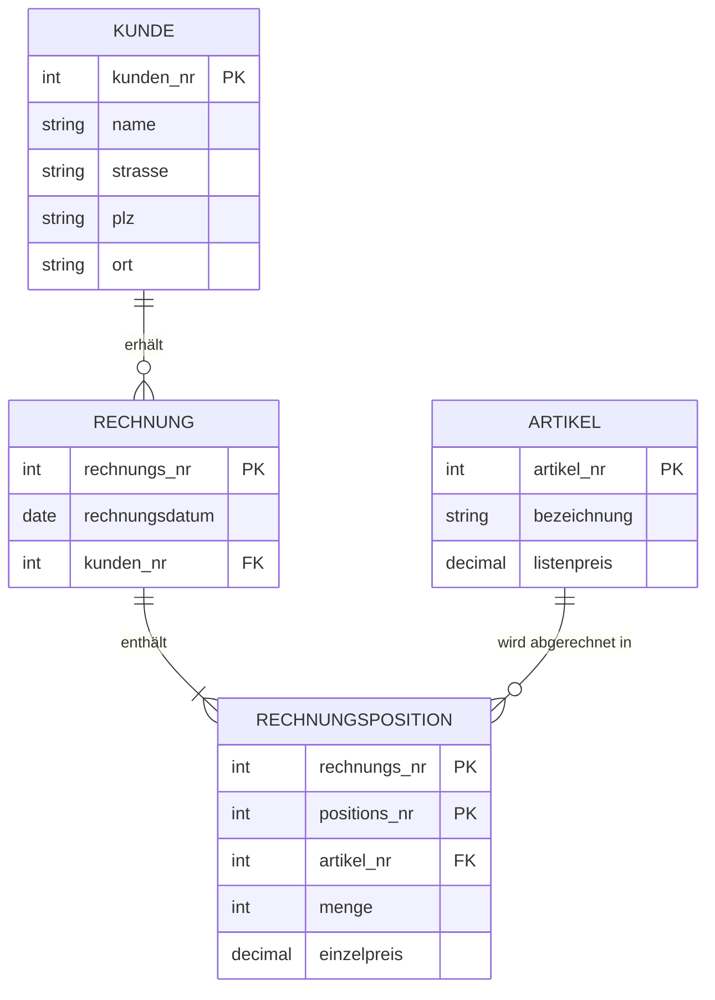

# 01.1 Relationale Modelle & Normalisierung

| | |
|---|---|
| **Modul** | 01 Relationale Modelle & Normalisierung (Priorität 1) |
| **Stufe** | Einsteiger |
| **Geschätzte Zeit** | 6 bis 9 Stunden (Schätzung; Lehrplan: 10 UE zu 45 Minuten = 7,50 Stunden) |
| **Werkzeuge** | Papier oder Texteditor; optional PostgreSQL und `psql` für die Prüfung der Zerlegung |
| **Vorwissen** | IT-Grundlagen, grundlegende Linux-Kommandozeile (Dateien bearbeiten, `sudo`, Dienste neu starten) |

> [!WARNING]
> **Stand der Prüfung: Entwurf, Fallstudie; Zerlegung der Flat-File in PostgreSQL 16 gegengeprüft.** Dieses Modul ist eine Fallstudie ohne Labor. Die **Rechnung und die Flat-File sind Material der Ausarbeitung** (frei erfunden; der Lehrplan sieht sie vom Kursleiter vor). Die Zerlegung der Flat-File in drei Tabellen wurde mit dem Hilfsskript `normalisierung-test.sql` in einer Wegwerf-Datenbank unter PostgreSQL 16 auf Verlustfreiheit geprüft (siehe `beispiele/m01.txt`). Alle Aussagen zu Normalformen und zum ER-Modell sind Fachwissen des Verfassers und nicht gegen eine Quelle geprüft.

## Lernziele

Nach dieser Übung kannst du

- die Konzepte relationaler Datenbanken erklären
- Entity-Relationship-Modelle lesen und einfache erstellen
- unstrukturierte Daten bis zur 3. Normalform (3NF) normalisieren

## Voraussetzungen

- IT-Grundkenntnisse

## Grundbegriffe

| Begriff | Bedeutung |
|---|---|
| **Relation / Tabelle** | Menge von Zeilen mit denselben Spalten |
| **Tupel** | eine Zeile einer Relation (ein Datensatz) |
| **Attribut** | eine Spalte einer Relation (eine Eigenschaft) |
| **Primärschlüssel** | Attribut(e), das jede Zeile eindeutig identifiziert; nie leer |
| **Fremdschlüssel** | Attribut, das auf den Primärschlüssel einer anderen Tabelle verweist |
| **Entität, Beziehung, Kardinalität** | Objekt der Fachwelt, Verbindung zwischen Entitäten, Zahlenverhältnis der Verbindung (1:1, 1:n, n:m) |
| **Redundanz, Anomalie** | mehrfach gespeicherte Information; führt zu Insert-, Update- und Delete-Anomalien |
| **1NF, 2NF, 3NF** | Normalformen: atomare Werte; keine Teilabhängigkeit vom Schlüssel; keine transitive Abhängigkeit |
| **Funktionale Abhängigkeit** | Der Wert eines Attributs bestimmt den Wert eines anderen (z. B. Abteilungsname → Standort) |

## Laborumgebung

| Was | Rolle in Modul 01 |
|---|---|
| Papier oder Texteditor | kein technisches Labor nötig; die VMs müssen nicht laufen |
| `kundenrechnung.md` | Vorlage für Aufgabe 1 |
| `flatfile.csv` | Vorlage für Aufgabe 2 |
| PostgreSQL (optional) | nur für die Prüfung der Zerlegung mit `normalisierung-test.sql` in einer Wegwerf-Datenbank; ab Modul 2 verfügbar |

## Aufgabe

### Aufgabe 1 – Fallstudie ERM (Einheit 1.1, Einheit 1.2)

Analysiere die vom Kursleiter bereitgestellte fiktive Kundenrechnung (Papier/PDF) und erstelle daraus ein fachliches Entity-Relationship-Modell.

### Aufgabe 2 – Fallstudie Normalisierung (Einheit 1.1, Einheit 1.3)

Überführe die vom Kursleiter bereitgestellte „Flat-File“-Tabelle (Mitarbeiter-, Abteilungs- und Projektdaten gemischt, z. B. mit den Spalten Mitarbeitername, E-Mail, Gehalt, Abteilungsname, Standort, Projektbezeichnung und Projektstart) schrittweise auf Papier in die 1., 2. und 3. Normalform. Das Ergebnis dient als Vorlage für die Tabellen in Modul 3.

*Ergänzung der Ausarbeitung (Einheit 1.1):* Lies die Flat-File (`flatfile.csv`) zuerst als Relation: Benenne die **Attribute** (Spalten) und die **Tupel** (Zeilen) und gib an, wie viele es sind. Lege einen Schlüsselkandidaten fest und begründe ihn (Hinweis: Nicht jede Spalte kommt in Frage, z. B. ist die E-Mail-Adresse bei Eva Berger leer).

*Material der Ausarbeitung:* Die Flat-File liegt als `flatfile.csv` vor (fünf Mitarbeiter, Annahme: Mitarbeiter arbeiten an den Projekten ihrer Abteilung; die Abteilung Verwaltung hat kein Projekt). Die Rechnung für Aufgabe 1 steht in `kundenrechnung.md`.

## Hinweise

- Eine ER-Modell-Skizze braucht keine Software: Rechtecke für Entitäten, Linien für Beziehungen, Kardinalitäten an den Linien. Die Musterlösung zeigt sie als Mermaid-Diagramm (wird auf GitHub dargestellt).
- Die **Reihenfolge der Normalformen** ist verbindlich: erst 1NF herstellen, dann 2NF, dann 3NF. Schreibe bei jedem Schritt auf, welche Abhängigkeit du gefunden hast.
- In der Flat-File hat jede Zeile einen einspaltigen Schlüssel; die 2NF ist dann **automatisch erfüllt** (Teilabhängigkeit gibt es nur bei zusammengesetzten Schlüsseln). Die Musterlösung erklärt das und zeigt, wann sie nicht erfüllt wäre.
- Das Ergebnis von Aufgabe 2 sind die drei Tabellen `abteilung`, `mitarbeiter` und `projekt` mit den Spaltennamen, die Modul 3 verwendet.
- Der Preis in der Rechnungsposition steht bewusst **in der Position** und nicht nur im Artikel: Er hält den Preis zum Zeitpunkt der Rechnung fest (Fachwissen); eine spätere Preisänderung des Artikels darf alte Rechnungen nicht verändern.

## Kontrollfragen

1. Was ist der Unterschied zwischen einem Attribut und einem Tupel?
2. Warum führt redundante Datenhaltung zu Anomalien (Insert, Update, Delete)?
3. Welche Bedingung muss erfüllt sein, damit sich eine Tabelle in der 2. Normalform befindet?
4. Was beschreibt die Kardinalität (z. B. 1:n) in einem ER-Modell?

## Musterlösung

Antworten und Zielzustand (erst nach dem Versuch öffnen)

**Aufgabe 1 (Fallstudie ERM).**

**Entitäten und Beziehungen (Vorschlag):** KUNDE, RECHNUNG, RECHNUNGSPOSITION und ARTIKEL. Ein Kunde erhält 0 bis n Rechnungen; eine Rechnung enthält 1 bis n Positionen; ein Artikel kommt in 0 bis n Positionen vor.

Hinweise zur Lösung: Die Summen (netto, Umsatzsteuer, brutto) sind **berechenbar** und werden nicht als eigene Attribute gespeichert (sonst Redundanz). `RECHNUNGSPOSITION` hat den zusammengesetzten Schlüssel (`rechnungs_nr`, `positions_nr`). Das Diagramm wurde mit dem Mermaid-Werkzeug auf Syntax geprüft, nicht auf GitHub dargestellt.

**Aufgabe 2 (Fallstudie Normalisierung).**

**Ausgangslage (Auszug aus `flatfile.csv`):** fünf Zeilen, sieben Spalten; Standort und Projekt stehen in jeder Zeile der Abteilung erneut.

**Anomalien in der Flat-File** (echt ausgeführt, `beispiele/m01.txt`): Ändert sich der Standort von Technik und wird nur **eine** Zeile angepasst, hat die Abteilung zwei Standorte (Linz: 2 Zeilen, Salzburg: 1 Zeile, Update-Anomalie). Wird Lukas Steiner gelöscht, verschwinden zugleich die Abteilung Vertrieb, der Standort Graz und das Projekt Kundenportal (Delete-Anomalie). Eine neue Abteilung ohne Mitarbeiter lässt sich nur mit einer Scheinzeile speichern (Insert-Anomalie).

**1NF (atomare Werte, Schlüssel):** `Mitarbeitername` ist nicht atomar und wird in `vorname` und `nachname` zerlegt; ein künstlicher Schlüssel `mitarbeiter_id` wird ergänzt (die E-Mail eignet sich nicht, Eva Berger hat keine).

| mitarbeiter_id | vorname | nachname | email | gehalt | abteilungsname | standort | projektbezeichnung | projektstart |
|---|---|---|---|---|---|---|---|---|
| 1 | Anna | Müller | anna.mueller@example.com | 3800,00 | Technik | Linz | Netzwerkmodernisierung | 2026-02-01 |
| … | … | … | … | … | … | … | … | … |

**2NF:** Der Schlüssel besteht aus einer Spalte, daher gibt es keine Teilabhängigkeit; die Tabelle ist bereits in 2NF.

**3NF (transitive Abhängigkeiten):** `mitarbeiter_id` → `abteilungsname` → `standort`, und (Annahme: je Abteilung höchstens ein Projekt in diesen Daten) `abteilungsname` → `projektbezeichnung`, `projektstart`. Standort und Projektdaten hängen also nur **über die Abteilung** vom Mitarbeiter ab und wandern in eigene Tabellen:

| Tabelle | Spalten | Schlüssel |
|---|---|---|
| `abteilung` | `abteilung_id`, `name`, `standort` | `abteilung_id` |
| `mitarbeiter` | `mitarbeiter_id`, `vorname`, `nachname`, `email`, `gehalt`, `abteilung_id` | `mitarbeiter_id`, Fremdschlüssel `abteilung_id` |
| `projekt` | `projekt_id`, `bezeichnung`, `startdatum`, `abteilung_id` | `projekt_id`, Fremdschlüssel `abteilung_id` |

**Probe (echt ausgeführt):** Aus den drei Tabellen lässt sich die Flat-File per Join vollständig rekonstruieren; beide Differenzen sind leer (0 und 0). Die Zerlegung ist damit verlustfrei.

**Ergänzung (Einheit 1.1):** Die Flat-File hat 7 Attribute und 5 Tupel. Schlüsselkandidat: `Mitarbeitername` (hier eindeutig, aber in der Praxis nicht); die E-Mail scheidet aus, weil ein Schlüssel nie leer sein darf; ein künstlicher Schlüssel ist die robuste Wahl.

**Fragen.** (1) Ein **Attribut** ist eine Spalte (Eigenschaft, z. B. `nachname`), ein **Tupel** eine Zeile (ein Datensatz, z. B. ein bestimmter Mitarbeiter). Die Tabelle als Ganzes heißt Relation. (2) Bei Redundanz steht dieselbe Information an mehreren Stellen. **Update-Anomalie:** Eine Änderung wird nicht überall nachgezogen (im Test hatte Technik danach zwei Standorte). **Insert-Anomalie:** Eine Abteilung ohne Mitarbeiter lässt sich nicht ohne Scheinzeile speichern. **Delete-Anomalie:** Beim Löschen des letzten Mitarbeiters einer Abteilung gehen auch Abteilung und Projekt verloren (im Test: Vertrieb). (3) Die Tabelle muss in der 1NF sein (atomare Werte) und **jedes Nichtschlüsselattribut muss vom gesamten Schlüssel abhängen**, nicht nur von einem Teil. Das ist nur bei einem zusammengesetzten Schlüssel zu prüfen; bei einem einspaltigen Schlüssel ist die 2NF automatisch erfüllt. (4) Die Kardinalität gibt an, wie viele Instanzen der einen Entität mit wie vielen der anderen verbunden sein können, z. B. 1:n (eine Abteilung hat viele Mitarbeiter, ein Mitarbeiter gehört zu höchstens einer Abteilung) oder n:m (ein Artikel kommt in vielen Positionen vor und eine Rechnung hat viele Artikel; aufgelöst über die Positionstabelle).

## Erweiterungen

- Erweitere die Flat-File um einen Mitarbeiter, der an **zwei** Projekten mitarbeitet. Welcher Schlüssel ist nun nötig, welche Teilabhängigkeiten entstehen, und welche zusätzliche Tabelle (Verbindungstabelle) brauchst du für die 2NF?
- Zeichne das ER-Modell der drei Tabellen aus Aufgabe 2 (`abteilung` 1:n `mitarbeiter`, `abteilung` 1:n `projekt`).
- Führe `normalisierung-test.sql` in einer Wegwerf-Datenbank aus (ab Modul 2) und ändere die Flat-File so, dass die Probe am Ende einen Unterschied meldet; erkläre warum.

## Quellen

- Normalformen, ER-Modell und Kardinalität werden als Begriffe verwendet; eine geprüfte Quelle liegt nicht vor (Fachwissen des Verfassers, nicht gegen eine Quelle geprüft).
- Zerlegung und Anomalien: eigener Lauf mit `normalisierung-test.sql` auf PostgreSQL 16.15 (siehe `beispiele/m01.txt`).
- **Testumgebung der Ausarbeitung (eigene Läufe, Namespaces im Container, nicht Hyper-V):** Ubuntu 24.04.5 im Cloud-Container mit zwei Netzwerk-Namespaces (`db-server`, `db-client`) statt VMs; PostgreSQL 16.15 (Ubuntu-Paket) mit dem Locale `de_AT.UTF-8`, `psql` 16.15 als Ersatz für DBeaver, GNU coreutils 9.4.
- PostgreSQL 15 Documentation, <https://www.postgresql.org/docs/15/index.html> (URL laut Lehrplan, **von mir nicht abgerufen**). Die Befehle wurden mit PostgreSQL 16.15 ausgeführt.
- Alle übrigen Aussagen in dieser Übung: Angaben des Lehrplans bzw. Fachwissen des Verfassers (Begriffe, Normalformen, Empfehlungen), **nicht gegen eine Quelle geprüft** und nicht mit PostgreSQL 15 auf Debian 12 ausgeführt; im Zweifel die PostgreSQL-Dokumentation lesen.
- Lehrplan P30 „SQL-Grundlagen“ (eigener Lehrplan der Reihe, Aufgabentexte und Kontrollfragen unverändert übernommen; Hinweise und Aufgabenteile „Ergänzung der Ausarbeitung“ sind gekennzeichnet).

---

*Lizenz: Text CC BY 4.0, Skripte MIT, siehe `LICENSE-DOCS.md` und `LICENSE` im Kursordner. PostgreSQL ist eine eingetragene Marke der PostgreSQL Community Association of Canada, DBeaver eine Marke der DBeaver Corp., Microsoft, Windows und Hyper-V sind Marken der Microsoft Corporation, Ubuntu ist eine Marke von Canonical Ltd., Debian eine eingetragene Marke von Software in the Public Interest, Inc., Linux eine Marke von Linus Torvalds. Alle Namen, E-Mail-Adressen (`example.com`), Adressen, Rechnungen und Kennwörter sind frei erfunden bzw. Laborwerte. Dieses Dokument steht in keiner Verbindung zu den genannten Markeninhabern.*
